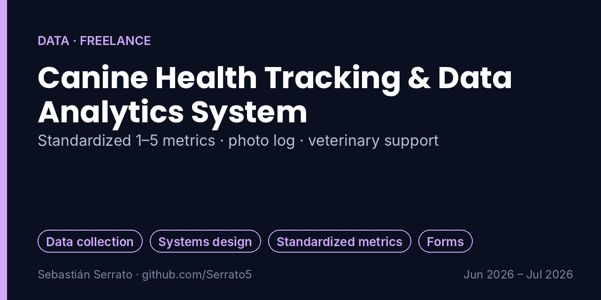
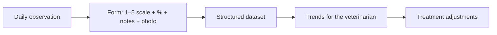

# Canine Health Tracking & Data Analytics System

**Standardized 1–5 metrics · photo log · veterinary support**

`Data collection` `Systems design` `Standardized metrics` `Forms`

## Overview

A structured digital monitoring system to record, standardize and analyze daily health observations for a dog with complex inflammatory bowel disease (IBD), built as part of my freelance pet-care work.

> **Privacy:** this project was built for a private client. No personal data, health records or photos of the client or the animal are included here; only the design of the system is described.

## Key features

- **Standardized metrics:** A 1-to-5 scale plus percentage metrics to remove subjectivity when evaluating daily digestive health.
- **Multi-variable logging:** Data-entry interface with precise date and time stamps and free-text observation fields.
- **Visual evidence:** Photo upload to compile and catalog daily evidence of the patient's condition.
- **Veterinary support:** A continuous history that helps the veterinarian spot trends, evaluate diet changes and adjust treatment.

## How it works

## What I learned

- Turning subjective observations into comparable numbers.
- Combining structured fields with photos and free text.
- Building tools that a non-technical person can use every day.

## Project context

| | |
|---|---|
| Context | Private client (freelance care services) |
| Dates | Jun 2026 – Jul 2026 |
| Area | Data · Freelance |

## Resumen en español

Sistema digital de seguimiento de salud para un perro con enfermedad inflamatoria intestinal: escala estandarizada de 1 a 5, campos de fecha, hora y observaciones, y carga de fotos, para que la veterinaria pueda ver tendencias y ajustar el tratamiento.

---

**About this repository:** the original source code and design files of this project were not preserved. This repository documents what was built, how it works and what I learned, based on my project records. It does not contain reconstructed code.

**Sobre este repositorio:** el código y los archivos originales de este proyecto no se conservaron. Aquí se documenta qué se construyó, cómo funciona y qué aprendí, sin código reconstruido.

**Author:** Sebastián Serrato Ramírez · Electronic Engineering student, Universidad Surcolombiana (Neiva, Colombia) · [LinkedIn](https://www.linkedin.com/in/sebaserrato) · [More projects](https://github.com/Serrato5)
